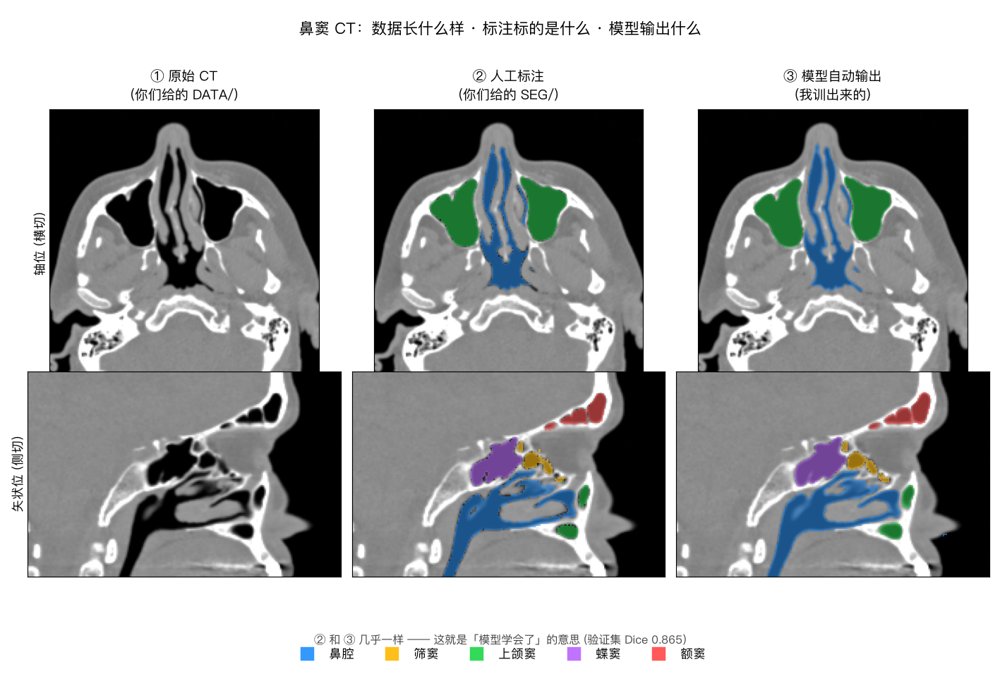
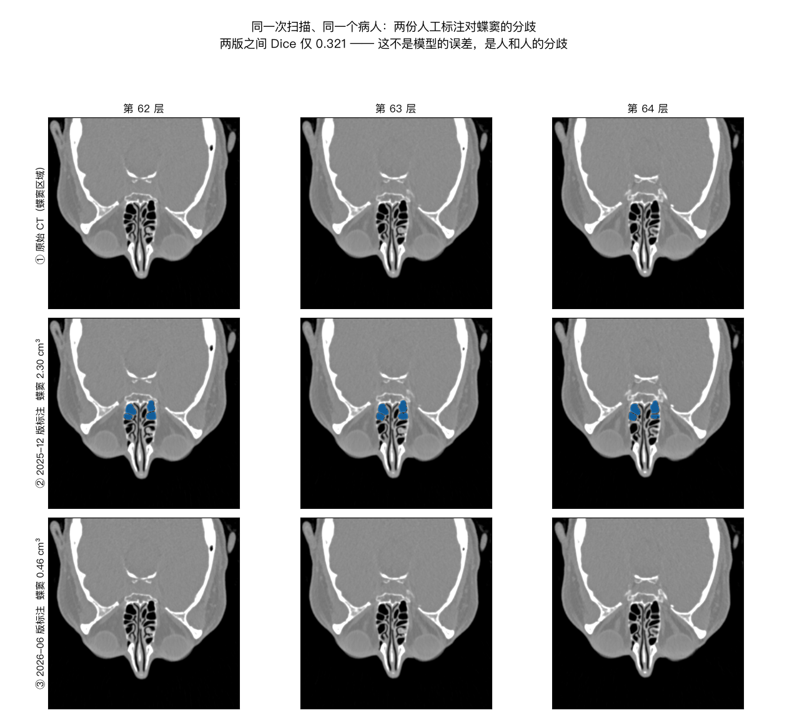

# Paranasal Sinus CT — Segmentation + Human-in-the-Loop Active Learning

A 3D segmentation model for the five paranasal sinus structures, plus the
human-in-the-loop tooling around it: the model ranks which unlabelled scans are
worth a clinician's time, and which already-labelled scans look mis-annotated.



*Left: the raw CT. Middle: the manual annotation in `SEG/`. Right: what the
trained model produces unaided on the same scan.*

> ### ⚠️ Privacy — read before cloning or forking
>
> **Keep this repository private.** `DATA/` and `SEG/` (raw CT volumes and
> annotations) are excluded by `.gitignore` and must never be committed — the
> filenames are medical record numbers.
>
> What *is* committed still carries patient identifiers: `work/manifest.json`,
> `work/missing_images.csv`, `work/disease_metrics_manual.json` and the example
> figures under `work/review/` and `work/pred/` contain MRNs and real patient
> imaging. Sagittal CT in particular permits facial reconstruction. Do not make
> this repository public, fork it to a personal account, or paste these files
> into external services.

---

## TL;DR

| | |
|---|---|
| **Task** | Segment 5 paranasal sinus structures in head CT |
| **Data** | 25 usable annotated scans (24 patients) — see §1 |
| **Model** | 3D DynUNet, 5.69M params, `work/runs/base_fold0/best.pt` (22 MB) |
| **Result** | **Mean Dice 0.865** on 5 held-out scans (fold 0 of 5; folds 1–4 not yet run) |
| **Status** | Segmentation works. Disease classification is **blocked on missing labels** — see §5 |
| **Biggest win available** | Recover 25 orphaned masks → dataset doubles, zero code changes — see §1.3 |

---

## 1. The data

### 1.1 What it is

```
DATA/  27 CT volumes      512×512×(89–423), in-plane 0.27–0.54 mm, slice 0.6–1.25 mm, LPS
SEG/   54 annotation masks 6 classes (background + 5 structures), same grid as the CT
```

The folders named `0(9)_all manual`, `N(k)_manual corrected` are **human-in-the-loop
annotation rounds that have already been run**: round 0 fully hand-drawn, rounds
1/3/4/5 model-predicted then human-corrected. (Round 2 is not present.)

### 1.2 Label semantics — recovered, not given

No label dictionary shipped with the data. The mapping was reconstructed from
three independent lines of evidence (RAS centroid position, connected-component
count, intensity) and then confirmed by rendering a mid-sagittal view:

| Label | Structure | Decisive evidence (29-mask audit) |
|---|---|---|
| 1 | Nasal cavity | **Exactly 1 connected component in 29/29 masks**; 38.6 ± 6.2 cm³; highest internal HU (turbinates) |
| 2 | Ethmoid | 2–11 components (honeycomb air cells); 8.3 ± 2.6 cm³, most variable |
| 3 | Maxillary | **Exactly 2 components in 28/29** (bilateral pair); largest, 36.7 ± 11.8 cm³ |
| 4 | **Sphenoid** | Smallest RAS *y* = most posterior; sits directly above the nasopharynx |
| 5 | **Frontal** | Largest RAS *y* and *z* = most anterior and superior; 2.5–16.4 cm³, can be near-aplastic |

> **Labels 4 and 5 were initially assigned the wrong way round.** NIfTI affines
> always map to RAS+, but the voxel axes in this dataset are LPS, which makes the
> sign of *y* easy to misread. The error was caught by rendering a sagittal slice:
> the anterior-to-posterior order must be frontal → ethmoid → sphenoid. If you
> write new analysis code against these labels, verify against
> `work/review/label_identity_sagittal.png` rather than trusting axis names.

### 1.3 Usable case count — and 25 masks that are being wasted

```
27 CT volumes
54 annotation masks
─────────────────────────────────────────────
25 usable (image, mask) pairs  ← what the model is trained on
 4 superseded older annotations (same scan re-annotated in a later round)
25 masks with NO matching CT   ← recoverable
```

Those 25 orphaned masks are finished annotation work with no image attached.
Recovering the source series from PACS roughly **doubles the training set** and
requires no code changes.

```bash
python scripts/missing_images.py     # writes work/missing_images.csv
```

The CSV lists patient ID, round, expected shape and expected slice thickness for
each missing series, which is enough to identify it in PACS. Drop the exported
`.nii.gz` into the matching `DATA/` round folder, rerun `manifest` and
`preprocess`, and it is picked up automatically.

---

## 2. The model

* **Preprocessing** — reorient to RAS → resample to **0.8 mm isotropic** → clip
  to [−1000, 1500] HU → global z-score weighted by foreground voxels.
* **Network** — MONAI `DynUNet` (nnU-Net topology), 5 levels, residual blocks,
  deep supervision, **5.69M parameters**.
* **Sampling** — **70% of patch centres are forced onto a random foreground
  class.** The smallest structures occupy ~0.01% of all voxels; without this they
  are effectively never sampled.
* **Loss** — Dice + cross-entropy, CE weighted by inverse-sqrt class frequency.
* **Splits** — **patient-grouped** 5-fold (`GroupKFold`). One patient has two
  scans; grouping stops them straddling train/val.
* **Inference** — Gaussian-weighted sliding window, optional 4-way flip TTA.

### Why 0.8 mm and not something finer

A 96³ patch at 0.6 mm spans only **58 mm**. The paranasal sinus complex spans
**70–80 mm** (measured: 26 mm anterior-posterior, 56 mm superior-inferior between
label centroids). A model that cannot see the surrounding landmarks cannot tell
ethmoid from sphenoid — this is a **semantic** failure, not a resolution one.

At 0.8 mm the same patch spans 77 mm: identical compute per step, double the
context. Measured effect, same epoch, same everything else:

```
0.6 mm, epoch 9 validation Dice:  0.255
0.8 mm, epoch 9 validation Dice:  0.397      (+56% relative)
```

Sinus cavities are high-contrast air-vs-bone structures; 0.8 mm is ample for
volumetry. The abandoned 0.6 mm run is excluded from the repo by `.gitignore`.

---

## 3. Results

### 3.1 Fold 0

Trained 120 epochs × 50 iterations on an Apple M2 Max (97 s/epoch, 3 h 15 m total).

| Structure | Dice |
|---|---|
| Maxillary | **0.914** |
| Nasal cavity | 0.885 |
| Frontal | 0.868 |
| Sphenoid | 0.845 |
| Ethmoid | 0.815 |
| **Mean** | **0.865** |

Per held-out case: 0.896, 0.892, 0.887, 0.845, 0.807.

Learning curve (validation Dice, every 10 epochs) — converged, no overfitting:

```
ep  9  0.397     ep 59  0.842     ep 109  0.863
ep 19  0.609     ep 69  0.855     ep 119  0.865
ep 29  0.773     ep 79  0.817
ep 39  0.836     ep 89  0.851
ep 49  0.762     ep 99  0.860
```

Full logs: `work/runs/base_fold0/log.jsonl`, `work/runs/base_fold0/val_ep*.json`.

### 3.2 How to read 0.865

Dice compares two shapes and is 1.0 when they coincide. Here it compares **model
output against the human annotation, on 5 scans the model never saw during
training** (zero overlap with the 20 training scans, grouped by patient).

It is **not** a measure of clinical correctness — it is agreement with one human
annotation, which §4.1 shows is itself not reproducible for every structure.

### 3.3 Caveat on scope

**This is one fold.** 20 training / 5 validation scans. The number is usable for
an internal report if labelled as single-fold, but it is not a cross-validated
result. Folds 1–4 are implemented and unrun (~3.2 h each):

```bash
for f in 1 2 3 4; do python -m sinus_hil.train --fold $f --tag base; done
```

---

## 4. Key findings

### 4.1 Annotation agreement is the real ceiling — and it is now measured ⚠️

Four scans in this dataset were annotated **twice**, in different rounds, on the
**identical voxel grid**. Comparing the two human annotations against each other
gives a direct estimate of inter-round annotator agreement. **No model is
involved in this measurement.**

| Structure | Inter-round Dice (4 scans) | |
|---|---|---|
| Nasal cavity | 0.95 – 1.00 | stable |
| Maxillary | 0.98 – 1.00 | stable |
| Frontal | 0.96 – 0.99 | stable |
| **Ethmoid** | **0.76 – 0.99** | unstable |
| **Sphenoid** | **0.32 – 1.00** | highly unstable |

Worst case, one scan, sphenoid sinus:

| | Round 0 (Dec 2025) | Round 4 (Jun 2026) | Change |
|---|---|---|---|
| Sphenoid volume | 2.30 cm³ | 0.46 cm³ | **−80%** |
| Dice between the two annotations | | | **0.321** |

On the slices where they differ most, one pass marks sphenoid and the other
marks nothing at all:



*Top row: the raw CT. Middle: the December 2025 annotation (sphenoid in blue).
Bottom: the June 2026 annotation of the identical slices — empty.*

**Implication for the team:**

1. **This is the ceiling on measurable model Dice.** The model scores 0.845 on
   sphenoid and 0.815 on ethmoid — already close to the agreement humans achieve
   with each other. Pushing these numbers higher by tuning is, past this point,
   fitting annotation noise.
2. **Which version is correct is a clinical question, not a technical one.**
   Plausible explanations include posterior ethmoid cells mislabelled as
   sphenoid, an under-corrected model miss, or genuinely borderline
   pneumatisation.
3. **The pipeline currently trains on the later round** (0.46 cm³ here) and
   discards the earlier one. If other cases in the cohort were annotated under
   the *earlier* convention, the model is being shown contradictory examples.

**Recommended action: agree an explicit written convention for the ethmoid and
sphenoid boundaries before investing further in model tuning.**

Reproduce:
```bash
python -c "from sinus_hil.review import round_drift; import json; print(json.dumps(round_drift(), ensure_ascii=False, indent=1))"
```

### 4.2 The annotations delineate the air cavity, not the bony sinus

Mean intensity inside every labelled structure is −600 to −940 HU, with
soft-tissue fraction only 2–23%. The annotators traced **air**, excluding
mucosa and fluid.

This determines how disease can be quantified: pathology shows up as the air
cavity *shrinking*, not as the cavity brightening. A Lund-Mackay style
opacification ratio needs the bony cavity as a denominator, which is not
annotated.

Two approaches to recovering the bony envelope were implemented and both failed:

1. **Geodesic dilation from the air cavity, constrained by bone** — leaks through
   the ostium, which is itself an air channel, into the nasal cavity. Every
   maxillary sinus in the cohort scored ~65% opacified, with the "filled" region
   averaging −76 HU, i.e. still air.
2. **Growth restricted to soft-tissue HU** — no longer leaks through the ostium,
   but escapes through vascular foramina and thin spots in the bony wall into the
   cheek. The filled region averaged 17–45 HU, i.e. muscle and fat.

**Conclusion: the bony cavity volume cannot be recovered from the air cavity
alone.** The failures are documented in `sinus_hil/disease.py::_focal_envelope`
so they are not repeated.

**If standard Lund-Mackay scoring is a project goal, the bony sinus boundary
needs to become a new annotation class.** That is a well-defined next annotation
round and fits the HIL loop directly.

### 4.3 Anatomical priors give a label-free correctness check

Anatomy that holds across the whole cohort can be turned into an automatic check
that needs no ground truth:

```
nasal cavity   exactly 1 connected component      (29/29 masks comply)
maxillary      exactly 2 (bilateral)              (28/29 comply)
ethmoid        2–11 components (honeycomb)
per-structure volume within an expected range
left-right symmetry within an expected range
```

Measured penalty (0 = perfectly plausible): **human annotations 0.016, model
output 0.036.** This is what makes it possible to flag a bad prediction on a scan
that has no annotation, and it is the component that catches *confidently wrong*
output — which entropy-based uncertainty by construction cannot.

---

## 5. Disease detection — blocked, and why

**There are no disease diagnosis labels anywhere in this dataset.** Every
annotation is anatomical ("this is the maxillary sinus"). Nothing records
"this patient has chronic rhinosinusitis" or "this patient is normal".

Supervised learning cannot proceed without targets, so **no disease classifier
has been trained, and none can be until labels exist.**

What *is* delivered is the complete quantitative pipeline feeding into one:

* Per sinus, per side: air volume, envelope volume, focal opacification, mean and
  p90 HU, in-cavity soft-tissue fraction, left-right asymmetry, cohort normative
  z-score, composite involvement score.
* **87-dimensional feature matrix**, `work/disease_features.npz`.
* Cohort normative table, `work/normative.json`.
* A 0–16 involvement total, deliberately **not** named Lund-Mackay (see below).

To connect a classifier, supply a two-column CSV:

```csv
case_id,label
<case>,0
<case>,1
```

```bash
python -c "from sinus_hil.disease import fit_classifier; fit_classifier('labels.csv')"
```

It imputes, fits gradient boosting, and reports stratified cross-validated AUC.

### Limitations that must not be dropped when citing these numbers

* **The involvement score is not Lund-Mackay.** No anterior/posterior ethmoid
  split, no ostiomeatal complex score, and the thresholds are uncalibrated.
  Using the name would imply comparability with published scores. It is not.
* **Thresholds (0.60 / 1.20) are chosen, not calibrated.** They must be re-derived
  against diagnosis labels before any clinical use.
* **Focal opacification saturates.** Measured across all 50 maxillary sinuses:
  median 0.013, max 0.029. Lund-Mackay's 0.15/0.85 cut-points would never fire.
  Uniform mucosal thickening shrinks the cavity proportionally, which is not a
  concavity, so bounded closing cannot detect it by construction. This is why the
  score takes the maximum of four signals rather than using opacification alone.
* **The "normative" table is not normative.** It is built from specialist sinus
  CT, a cohort almost certainly enriched for disease. It is closer to "our cohort
  median" than "normal". Rebuild against proper controls.

---

## 6. Usage

### Setup

```bash
python3 -m venv .venv
.venv/bin/pip install numpy nibabel scipy scikit-learn torch monai \
                     tqdm matplotlib pandas SimpleITK joblib
```

Runs on CUDA, Apple MPS or CPU — `sinus_hil.config.device()` picks automatically.
MPS was measured ~4.4× faster than CPU on an M2 Max.

### Full pipeline

```bash
./scripts/run_pipeline.sh
```

Or step by step:

```bash
python -m sinus_hil.manifest                    # pair DATA/ with SEG/  -> work/manifest.json
python scripts/missing_images.py                # audit orphaned masks
python -m sinus_hil.preprocess --jobs 5         # -> work/cache (~640 MB, gitignored)
python -m sinus_hil.train --fold 0 --tag base   # ~3.2 h on an M2 Max
```

### Inference on new scans

```bash
python scripts/predict.py --ckpt work/runs/base_fold0/best.pt --input /path/to/ct_dir
```

Per case: `*_seg.nii.gz` (open in 3D Slicer / ITK-SNAP), quantitative metrics in
`predictions.json`, anatomical plausibility score, and a PNG of the slices most
worth reviewing. ~30 s per case.

### Active learning round

```bash
python -c "
from sinus_hil.active_learning import run_round
run_round('work/runs/base_fold0/best.pt', pool_dir='/path/to/unlabelled_ct', k=5)"
```

Produces `work/al/round0/`: `worklist.html` (priority-ranked), `*_pred.nii.gz`
(pre-annotations to correct rather than draw from scratch), `*_unc.npy`
(uncertainty maps), `*.png` (priority slices).

After the annotator finishes:

```bash
python -c "
from sinus_hil.active_learning import commit_round
commit_round(['<new_case_id>'], val_mean_dice=0.87)"
```

### Review existing annotations

```bash
python -c "from sinus_hil.review import run; run('work/runs/base_fold0/best.pt')"
```

Produces `work/review/worklist.html` plus per-case triptychs
(CT+prediction / CT+human annotation / suspect-region heat map).

The ranking criterion is **not** low Dice. It is *high model confidence combined
with disagreement*: where the model is vague the model is usually at fault; where
it is confident and still disagrees is where annotation noise concentrates.

### Disease metrics

```bash
python -m sinus_hil.disease                                      # from manual annotations
python -m sinus_hil.disease --ckpt work/runs/base_fold0/best.pt  # from model predictions
```

### Does active learning actually help?

Not yet verified on this data. The controlled back-test is implemented:

```bash
python scripts/al_simulate.py --quick      # ~2 h on an M2 Max
python scripts/al_simulate.py --epochs 30  # slower, more trustworthy
```

Holds out a fixed test set, seeds a small labelled set, and runs AL against
random selection for several rounds, comparing Dice at equal annotation budget.

---

## 7. Active-learning scoring

Four complementary signals, weighted into one ranking score:

| Signal | Catches | Weight |
|---|---|---|
| Predictive entropy | ambiguous boundaries the model knows about | 0.30 |
| MC-dropout variance + label-flip rate | model-parameter uncertainty | 0.25 |
| Flip-TTA disagreement | non-robustness to spatial transforms | 0.20 |
| **Anatomical prior violation** | **confidently wrong output** | 0.25 |

The fourth signal is the one that earns its place. Entropy-based measures cannot
by construction detect a confident error; an anatomical check can (§4.3).

Selection then applies a **diversity** term (greedy de-duplication over pooled
encoder bottleneck features) so a batch is not five near-identical scans.

---

## 8. Repository layout

```
sinus_hil/
  config.py            paths, label semantics, anatomical priors, hyperparameters
  manifest.py          DATA/SEG pairing, cross-round dedup, orphan-mask audit
  preprocess.py        reorientation / resampling / normalisation / .npy cache
  dataset.py           foreground-oversampled patch sampling, 3D augmentation, grouped splits
  model.py             DynUNet construction, MC-dropout switch
  losses.py            Dice+CE with deep supervision, per-class Dice
  train.py             training loop, sliding-window validation, checkpointing
  inference.py         sliding-window inference, TTA, MC-dropout, NIfTI writeback
  uncertainty.py       four-signal uncertainty, anatomical plausibility, slice ranking
  active_learning.py   round management, diversity-aware batch selection, worklists
  review.py            annotation-noise localisation, cross-round drift measurement
  disease.py           envelope estimation, opacification, normative z-scores, classifier scaffold
  report.py            overlay PNG sheets, HTML worklists
scripts/
  run_pipeline.sh      end-to-end
  predict.py           inference on new scans
  missing_images.py    orphaned-mask audit
  al_simulate.py       AL vs random controlled back-test
work/                  derived artifacts (cache/ and large checkpoints gitignored)
```

Code comments and docstrings are in English. Runtime output, figure labels and
HTML worklists are in Chinese, matching the annotators' working language.

---

## 9. Recommended priorities

1. **Recover the 25 orphaned CT series** (§1.3). Doubles the dataset, no code
   changes, highest return on effort available.
2. **Agree a written convention for ethmoid and sphenoid boundaries** (§4.1).
   Until this is fixed, model scores on those structures are capped by annotation
   noise and further tuning is wasted effort.
3. **Collect disease diagnosis labels** (§5). This — not model capacity — is the
   bottleneck on the stated goal of automatic disease detection. Even binary
   has/doesn't-have labels on the existing 25 cases would unblock the pipeline.
4. **Add a bony sinus boundary annotation class** if standard Lund-Mackay scoring
   is required (§4.2).
5. **Run folds 1–4** for a citable cross-validated number (§3.3), and
   **run the AL back-test** (§6) to confirm active learning earns its complexity.
